 

  
  
  

 

**MBA candidate at SPJIMR.** Before that, three and a half years as the only embedded engineer on the
A10 Networks account at Incedo, where I grew from DevOps Engineer to Senior DevOps Engineer in 27 months.
I'm moving into product management in cyber security, because I've spent years on the receiving end of
the gaps products leave open.

 

 

 

`Roadmapping` &nbsp; `Backlog prioritisation` &nbsp; `Stakeholder management` &nbsp; `Release management`
 
`Root-cause analysis` &nbsp; `Cyber security` &nbsp; `LLM and RAG applications` &nbsp; `Kubernetes` &nbsp; `AWS and OCI`

 

#### ✦ &nbsp; Try this on the site &nbsp; ✦

Move your cursor around my face. The head follows it.
Then click any skill to see the proof behind it, or switch to the network view.

 

NACRA case author &nbsp;·&nbsp; 2x ICE Award &nbsp;·&nbsp; Coding Club co-founder &nbsp;·&nbsp; Consultathon 5.0 finalist

 

© Yash Goyal. The code is here to read and learn from; please don't republish the site as your own.

